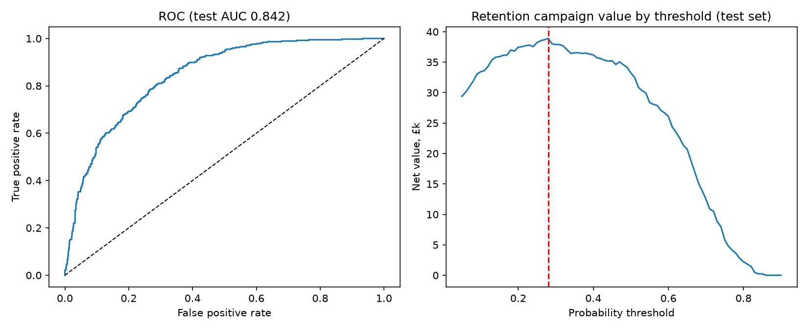
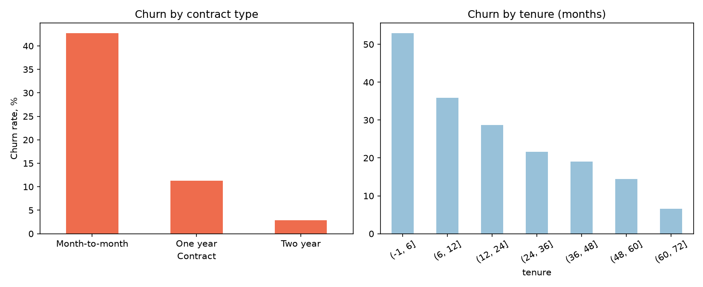
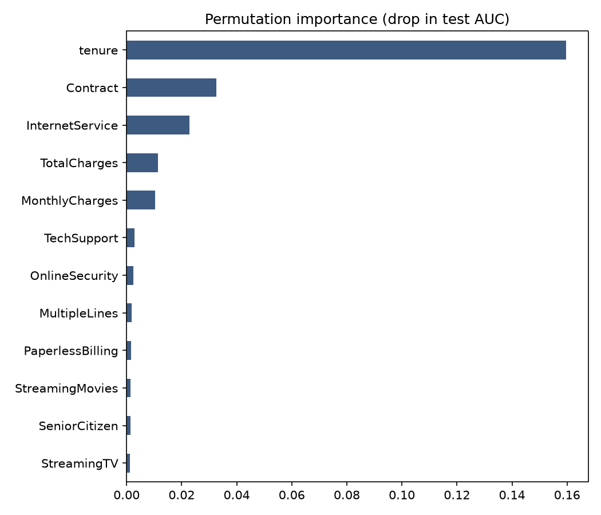
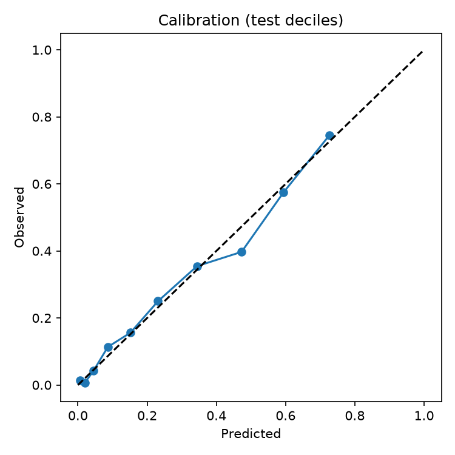

# Churn MLOps: from churn model to a tested, containerised scoring API

A production-style customer churn project. It covers a reproducible training pipeline, a model chosen on cross-validated AUC,
a decision threshold set by business value rather than 0.5, a validated **FastAPI** service, a **Docker** image,
**pytest** tests, **GitHub Actions CI**, and a **drift-monitoring** check (PSI).

Author: Anthony Adusei-Poku ([@anthony07-max](https://github.com/anthony07-max))



## Key findings (IBM Telco Customer Churn, 7,043 customers, 26.5% churned)
1. **Contract type is the clearest business signal.** Churn is 42.7% on month-to-month contracts, 11.3% on one-year and
   only 2.8% on two-year contracts.
2. **The first year is the danger zone.** 47.4% of customers in their first 12 months churn, against 9.5% after 4 years.
   Tenure is the most important feature by permutation importance (AUC drop 0.16), well ahead of contract and internet type.
3. **Simple beats complex here.** Regularised logistic regression (5-fold CV AUC 0.846) edged out gradient boosting (0.844),
   so the simpler, explainable model ships. Test AUC 0.842, PR-AUC 0.635, Brier score 0.138.
4. **Use a business threshold, not 0.5.** Assumptions: £50 per contacted customer, a saved customer is worth 12 months of charges,
   and 25% of contacted churners are saved. On that basis the best threshold is **0.28**. It contacts 40% of customers,
   catches 78% of churners, and is worth about £38.9k net on the 1,409-customer test set.
   These are illustrative assumptions, so change them in `train.py`.

| | |
|---|---|
|  |  |



## Architecture
```
data/raw/telco_churn.csv --> churn.train --> models/churn_model.joblib (pipeline + threshold + version)
                                       \--> data/processed/reference_sample.csv (training distribution)
models/churn_model.joblib --> api/main.py (FastAPI, pydantic validation) --> Docker image
new batch + reference sample --> churn.monitor (PSI drift report)
```
- `src/churn/features.py` holds one schema and cleaning function shared by training and serving, which avoids training/serving skew.
- `api/main.py` serves `GET /health` and `POST /predict` (batch). Bad categories or negative values are rejected with a 422.
- `tests/` covers health, output range, sensible risk ordering, input validation, and PSI behaviour.
- `.github/workflows/ci.yml` runs the tests, builds the Docker image and smoke-tests the container on every push.

## Model monitoring notes
- **Data drift:** `python -m churn.monitor new_batch.csv` computes the PSI per feature against the training sample.
  Bands: under 0.1 is stable, 0.1 to 0.25 is watch, over 0.25 is drift. The demo batch uses the real month-to-month fibre customers to mimic a segment shift,
  and it flags InternetService, Contract and MonthlyCharges as drifted (`monitoring/drift_report_demo.csv`).
- **Performance:** churn labels arrive late (about 1 month). Log every prediction with its model version, join outcomes when they land,
  and track AUC, calibration and recall at the threshold monthly. Retrain if AUC falls below 0.80 or several key features show drift.
- **Business:** track the contact rate and the save rate of the campaign, because the threshold depends on them.
- **Versioning:** the artefact carries `version`, which `/health` returns. Bump it on every retrain.

## Data source
- [IBM Telco Customer Churn sample dataset](https://github.com/IBM/telco-customer-churn-on-icp4d/blob/master/data/Telco-Customer-Churn.csv)
  (public sample data published by IBM, also on [Kaggle](https://www.kaggle.com/datasets/blastchar/telco-customer-churn)).

## How to run
```bash
python -m venv .venv && source .venv/bin/activate
pip install -r requirements.txt
bash run_pipeline.sh                      # download -> train -> drift demo -> tests
PYTHONPATH=src uvicorn api.main:app --reload   # http://localhost:8000/docs

# or with Docker
docker build -t churn-api . && docker run -p 8000:8000 churn-api
curl -X POST localhost:8000/predict -H 'content-type: application/json' -d @example_request.json
```
